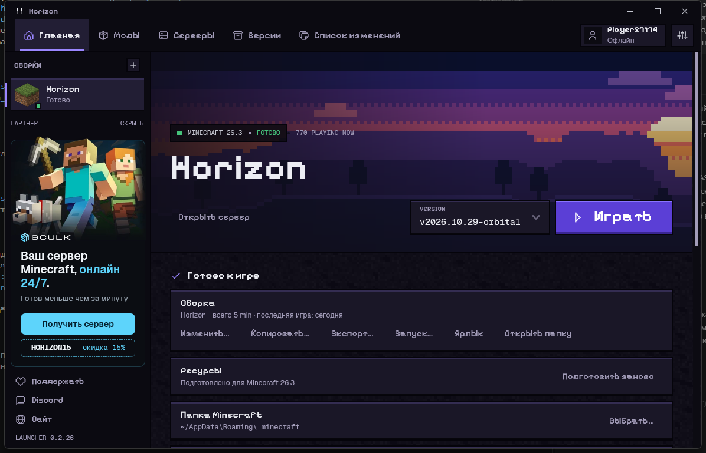
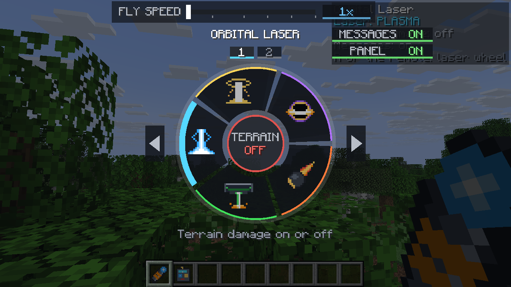

# Horizon Offline Setup — кросс-платформенный порт

[English version → README.en.md](README.en.md)


> 🎮 Один скрипт, чистая установка Horizon и оффлайн-игра без лишних костылей.
> Minecraft-файлы не хранятся в репозитории: они скачиваются с публичных серверов
> Mojang и проверяются по SHA-1.

<p align="center">
  
</p>

<p align="center"><sub>Horizon launcher with a prepared 26.3 installation.</sub></p>

Играй в [Horizon](https://playhorizon.dev) — клиент Minecraft: Java Edition 26.3,
переписанный на Rust — со своим лаунчером, **полностью оффлайн и без аккаунта
Microsoft** (однопользовательская игра, LAN, серверы в offline-режиме).

Это порт [slycat555/horizon-offline-setup](https://gitea.com/slycat555/horizon-offline-setup).
Оригинал работал **только на Linux (x86-64)**; здесь скрипт перенесён на
Windows, macOS и Linux — сам определяет систему.

Проверено пользователем на Windows x64 с nightly от 2026-10-29.
Linux и macOS в этой работе не проверялись. ARM не поддерживается:
скрипт выбирает библиотеки x86-64.

> В этом репозитории **нет файлов Minecraft**. Только скрипт-загрузчик: он качает
> всё на лету с публичных серверов Mojang (`piston-meta.mojang.com`,
> `piston-data.mojang.com`, `resources.download.minecraft.net`). Загружаемые jar,
> библиотеки, индекс и объекты ассетов проверяются по SHA-1 Mojang.

## Что это делает

`fetch_minecraft.py` собирает стандартную папку игры, которую читает лаунчер
Horizon (~555 МБ):

- `versions/26.3/26.3.json` + клиентский jar (41 МБ)
- серверный jar 26.3 (62 МБ)
- библиотеки, которые version JSON выбирает под текущую ОС
- индекс ассетов и звуки (~377 МБ), панорама главного меню, шрифт Unifont

Файлы загрузок проверяются по SHA-1; повторный запуск скачивает только
недостающее и повреждённое. Оборванный файл скачивается заново целиком;
возобновления с последнего байта нет. Уже существующий version JSON
скрипт пока не перепроверяет.

<details>
<summary>✨ Что получится после установки</summary>

1. Папка Minecraft 26.3 с клиентом, сервером, библиотеками и нужными ассетами.
2. Подготовленные ресурсы, которые понимает Horizon.
3. Оффлайн-имя и запуск из окна лаунчера без Microsoft-аккаунта, если включён
   `dev_offline`.

</details>

## Отличия от оригинала (Linux-only → кросс-платформа)

| Что | Было (Linux) | Стало |
|-----|--------------|-------|
| Путь к папке | `~/.minecraft` | `%APPDATA%\.minecraft` (Windows), `~/Library/Application Support/minecraft` (macOS), `~/.minecraft` (Linux) — как в `horizon-prepare` |
| Фильтр библиотек | только `os.name == "linux"` | `linux` / `windows` / `osx` |
| Версия системы для правил | команда `uname -r` | `platform.release()` |

Также в список принятых SHA-1 добавлен 5-й из `research-lock.json` (его не было
в оригинале).

## Запуск

Нужен Python 3.8+ (только стандартная библиотека).

```powershell
# Windows (PowerShell)
python fetch_minecraft.py
```

```bash
# Linux / macOS
python3 fetch_minecraft.py
```

Скачать в конкретную папку:

```powershell
python fetch_minecraft.py --minecraft-dir "D:\mc-offline\.minecraft"
```

Либо задать переменной окружения `HORIZON_MINECRAFT_DIR` (её читает и сам
лаунчер, и `horizon-prepare`).

## Дальше — лаунчер

```powershell
horizon-launcher settings minecraft-dir "$env:APPDATA\.minecraft"
horizon-launcher prepare --minecraft "$env:APPDATA\.minecraft"
horizon-launcher
```

### Важно: оффлайн на свежих версиях лаунчера

В проверенной nightly от 2026-10-29 оффлайн-имя требует **аккаунт Microsoft,
владеющий игрой**, даже для оффлайна. Полностью без аккаунта разрешает скрытая
опция разработчика `dev_offline`:

1. Открой окно лаунчера (`horizon-launcher` без подкоманды).
2. Кликни **7 раз** по версии лаунчера в сайдбаре.
3. В Настройках появится **Developer options** → включи **«Offline names
   without an account»**.

Или проще — добавь в `%APPDATA%\horizon-launcher\settings.json`:

```json
"dev_offline": true
```

Запускать игру после этого **из окна лаунчера**, а не через консоль:
`horizon-launcher play` не умеет оффлайн-без-аккаунта (параметр в коде
захардкожен). Подробности — в [`docs/launcher-offline.md`](docs/launcher-offline.md).

## Как это работает технически

Скрипт качает `version_manifest_v2.json` с Mojang, находит в нём версию `26.3`,
скачивает её version JSON, клиентский и серверный jar, библиотеки (по правилам
ОС) и нужные ассеты. Все URL и SHA-1 — те же, что использует официальный
лаунчер, поэтому Horizon ничего не «взламывает»: файлы просто берутся напрямую
у Mojang, а не из установки, привязанной к аккаунту.

## Публикация на GitHub

```bash
git init
git config user.name "ZLOY"
git config user.email "ZLOY13131313@admin.com"
git add .
git commit -m "Подготовлен кроссплатформенный загрузчик Horizon"
```

Порт сделан по запросу команды Horizon. Перед публикацией укажи ссылку на
оригинальный проект и согласуй с командой Horizon способ публикации и лицензию.
Английская пошаговая инструкция находится в [`README.en.md`](README.en.md).

## Благодарности

Оригинальная идея и скрипт — [slycat555/horizon-offline-setup](https://gitea.com/slycat555/horizon-offline-setup).
Кроссплатформенный порт, правки SHA-1 и разбор `dev_offline` в лаунчере
выполнены в рамках этой работы.

<p align="center">
  
</p>

<p align="center"><sub>Пример Horizon с модом Orbital Laser после подготовки ресурсов.</sub></p>
